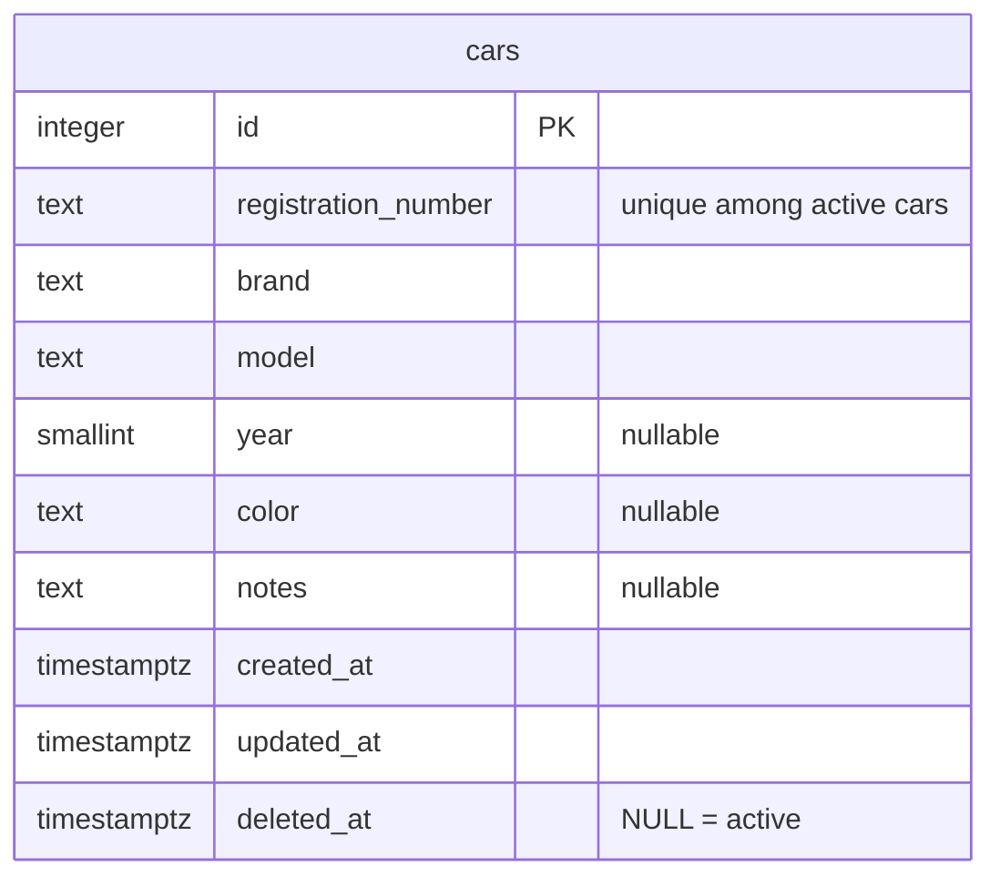

# Haupcar Car Management

A web application for recording and managing the company's car information, replacing the paper notebook so the data is safe and easy to share with every employee.

Built as the take-home test for the Full-Stack Developer position at Haupcar Co., Ltd.

## Features

| Requirement | Where |
|---|---|
| Add a new car (registration number, brand, model, notes, year, color) | **Add car** button → `/cars/new` |
| View all cars | Home page `/` |
| Edit a car | Pencil icon → `/cars/:id/edit` |
| Delete a car (with confirmation) | Trash icon → confirm dialog |

## Tech Stack

| Layer | Technology |
|---|---|
| Frontend | React 19, TypeScript, Vite, Tailwind CSS v4, shadcn/ui (Base UI), React Router, React Hook Form + Zod, Axios |
| Backend | Node.js, Express 5, TypeScript, Zod, Prisma ORM 7 |
| Database | PostgreSQL 17 |
| Tooling | Docker Compose, tsx, oxlint |

## Project Structure

```
haupcar-car-management/
├── docker-compose.yml        PostgreSQL + database migration + API
├── docs/database.dbml        Database diagram (open in https://dbdiagram.io)
├── backend/
│   ├── prisma/               Prisma schema and SQL migrations
│   └── src/
│       ├── app.ts            Express app (middleware, routes, error handling)
│       ├── server.ts         Starts the HTTP server
│       ├── config/           Environment variables and database client
│       ├── middlewares/      validate, notFound, errorHandler
│       ├── modules/cars/     schema → controller → service (one folder per feature)
│       └── utils/
└── frontend/
    └── src/
        ├── pages/            One component per route
        ├── features/cars/    API calls, hooks, form schema and components for cars
        ├── components/       App layout and shadcn/ui components
        └── lib/              Axios client and API error helper
```

## Getting Started

### Prerequisites

- [Docker Desktop](https://www.docker.com/products/docker-desktop/)
- [Node.js](https://nodejs.org/) 22.12 or newer (for the frontend)

### Option A: Run the API with Docker (recommended)

```bash
# 1. Start PostgreSQL, apply migrations and start the API on http://localhost:5000
docker compose up -d --build

# 2. Start the frontend on http://localhost:5173
cd frontend
cp .env.example .env
npm install
npm run dev
```

Open http://localhost:5173.

### Option B: Run everything locally (for development)

```bash
# 1. Start only PostgreSQL
docker compose up -d postgres

# 2. Backend (http://localhost:5000, reloads on save)
cd backend
cp .env.example .env
npm install            # also generates the Prisma client
npm run db:deploy      # create the tables
npm run dev

# 3. Frontend, in a second terminal (http://localhost:5173)
cd frontend
cp .env.example .env
npm install
npm run dev
```

> If you started Option A before, stop the API container first (`docker compose stop api`) so port 5000 is free.

### Useful commands

| Where | Command | What it does |
|---|---|---|
| root | `docker compose down` | Stop all containers (data is kept) |
| root | `docker compose down -v` | Stop and delete the database data |
| backend | `npm run db:studio` | Browse the database in Prisma Studio |
| backend | `npm run db:migrate` | Create a new migration after editing `schema.prisma` |
| backend / frontend | `npm run typecheck` | Type-check without running |
| frontend | `npm run lint` | Lint with oxlint |
| backend / frontend | `npm run build` | Production build |

## API

Base URL: `http://localhost:5000/api/v1`

| Method | Endpoint | Description | Success | Errors |
|---|---|---|---|---|
| GET | `/cars` | List all cars (newest first) | 200 | |
| GET | `/cars/:id` | Get one car | 200 | 400, 404 |
| POST | `/cars` | Create a car | 201 + `Location` header | 400, 409 |
| PUT | `/cars/:id` | Replace a car's data | 200 | 400, 404, 409 |
| DELETE | `/cars/:id` | Delete a car (soft delete) | 204 | 400, 404 |

Request body for `POST` and `PUT`:

```json
{
  "registrationNumber": "1กข 1234 กรุงเทพมหานคร",
  "brand": "Toyota",
  "model": "Yaris",
  "year": 2022,
  "color": "White",
  "notes": "Pool car for the sales team"
}
```

`registrationNumber`, `brand` and `model` are required. `year`, `color` and `notes` are optional; send `null` or omit them.

Every error uses the same shape:

```json
{
  "error": {
    "message": "Registration number already exists",
    "details": [{ "field": "registrationNumber", "message": "This registration number is already registered" }]
  }
}
```

## Database Design



The full diagram with notes is in [`docs/database.dbml`](docs/database.dbml).

## Additional Features

Beyond the basic requirements:

- **Soft delete.** Deleting a car sets `deleted_at` instead of removing the row, so the history is kept and a mistaken delete can be recovered.
- **Unique registration numbers among active cars.** A partial unique index (`WHERE deleted_at IS NULL`) blocks duplicates, while still allowing a deleted car's registration number to be registered again.
- **Validation on both sides.** Zod schemas validate the form in the browser and the request on the server. Errors from the API, such as a duplicate registration number, are shown under the matching form field.
- **Consistent API errors** with correct HTTP status codes (400, 404, 409, 500), handled in one central error handler.
- **One-command setup** with Docker Compose, including automatic database migrations.
- **Loading, empty and error states** in the UI, with a retry button when the API is unreachable.

## Design Decisions

- **Feature-based folders** (`modules/cars`, `features/cars`): everything about cars lives together, so adding a new feature means adding a folder rather than touching every layer's folder.
- **Controller → service → database layers**: controllers only translate HTTP, services hold the business rules and never see `req`/`res`.
- **Typed validation helper**: `validate()` passes the parsed `params` and `body` into the handler, so types flow from the Zod schema without casting `req.body`.
- **`PUT` replaces the whole record**, so create and update share one schema and omitted optional fields are cleared.
