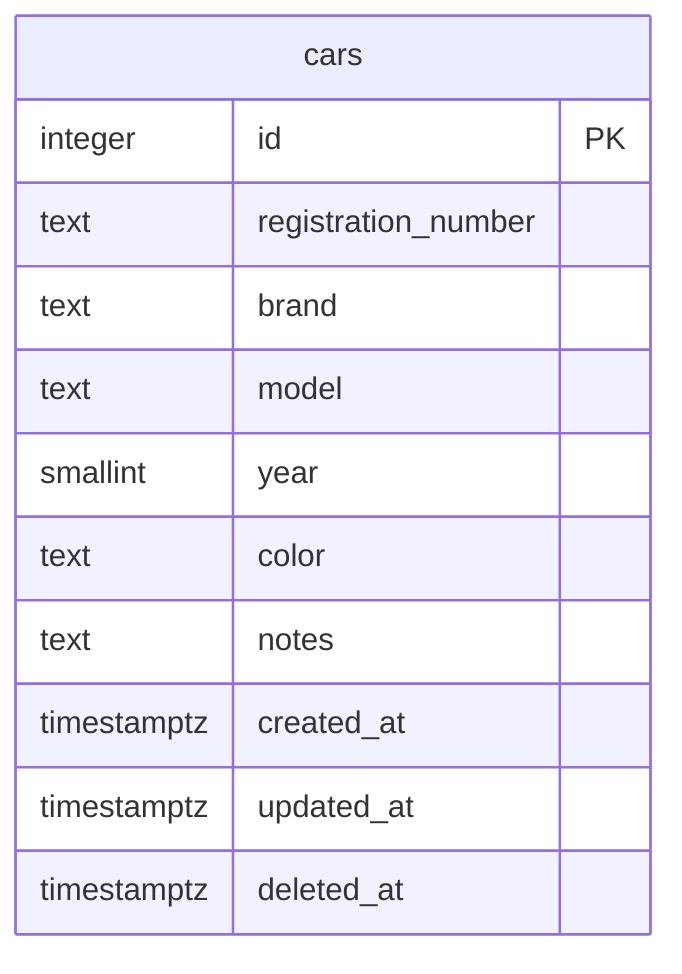

# Car Management

Take-home assignment for the Full-Stack Developer position at Haupcar.

A small web app for keeping track of the company's cars (registration number, brand, model, year, color, notes) instead of writing them down in a notebook. You can add, list, edit and delete cars. Deleting is a soft delete, so the row stays in the database.

## Stack

- Frontend: React 19 + TypeScript, Vite, Tailwind v4, shadcn/ui, React Router, React Hook Form + Zod, Axios
- Backend: Node.js, Express 5, TypeScript, Zod, Prisma 7
- Database: PostgreSQL 17 (Docker)

## Running it

You need Docker Desktop and Node.js 22.12+.

### With Docker

```bash
docker compose up -d --build
```

This starts Postgres, runs the migrations and starts the API on http://localhost:5000.

Then start the frontend:

```bash
cd frontend
cp .env.example .env
npm install
npm run dev
```

Open http://localhost:5173.

### Running the API locally

Handy when working on the backend, since `npm run dev` reloads on save.

```bash
docker compose up -d postgres

cd backend
cp .env.example .env
npm install        # also runs prisma generate
npm run db:deploy
npm run dev
```

Start the frontend the same way as above in another terminal. If the `api` container from the Docker setup is still running, stop it first with `docker compose stop api`, otherwise port 5000 is already taken.

### Other commands

- `docker compose down` stops everything. Add `-v` to also wipe the database.
- `npm run db:studio` (backend) opens Prisma Studio.
- `npm run db:migrate` (backend) creates a new migration after changing `schema.prisma`.
- `npm run typecheck` and `npm run build` work in both folders, `npm run lint` in the frontend.

## API

Base URL: `http://localhost:5000/api/v1`

```
GET    /cars        list cars, newest first
GET    /cars/:id    get one car
POST   /cars        create a car (201 + Location header)
PUT    /cars/:id    update a car
DELETE /cars/:id    soft delete a car (204)
```

Body for POST and PUT:

```json
{
  "registrationNumber": "1กข 1234 กรุงเทพมหานคร",
  "brand": "Toyota",
  "model": "Yaris",
  "year": 2022,
  "color": "White",
  "notes": "Pool car for the sales team"
}
```

`registrationNumber`, `brand` and `model` are required, the rest can be `null` or left out. PUT replaces the whole record, so any optional field you leave out gets cleared.

Errors always come back in this format:

```json
{
  "error": {
    "message": "Registration number already exists",
    "details": [{ "field": "registrationNumber", "message": "This registration number is already registered" }]
  }
}
```

400 means invalid input, 404 means the car doesn't exist (or was deleted), 409 means the registration number is already used.

## Database

There's only one table, `cars`. The diagram is in [`docs/database.dbml`](docs/database.dbml), you can paste it into https://dbdiagram.io to view it.



`deleted_at` is `NULL` while a car is active. Registration numbers must be unique, but only among active cars. I did this with a partial unique index (`WHERE deleted_at IS NULL`), so after a car is deleted its plate can be registered again.

## Project layout

```
backend/
  prisma/              schema and migrations
  src/
    config/            env variables, Prisma client
    middlewares/       validate, notFound, errorHandler
    modules/cars/      routes, controller, service, zod schema
frontend/
  src/
    pages/             one component per route
    features/cars/     api calls, hooks, form schema, components
    components/        layout + shadcn/ui components
    lib/               axios client, error helper
docs/database.dbml
docker-compose.yml
```

Code is grouped by feature instead of by type, so everything about cars is in one place. On the backend the controller only handles the request and response, and the service does the database work. Request validation goes through a small `validate()` helper that passes the parsed params and body to the handler, so there's no need to cast `req.body`.

## Extras

Things I added on top of the basic requirements:

- Soft delete with the partial unique index described above
- Zod validation on both the frontend and the backend. Errors from the server, like a duplicate plate, show up under the matching form field.
- One error handler for the whole API, so every error has the same format
- Docker Compose runs the migrations automatically before starting the API
- Loading, empty and error states in the UI, with a retry button if the API is down

## If I had more time

- Search and pagination
- Restoring deleted cars
- Automated tests
